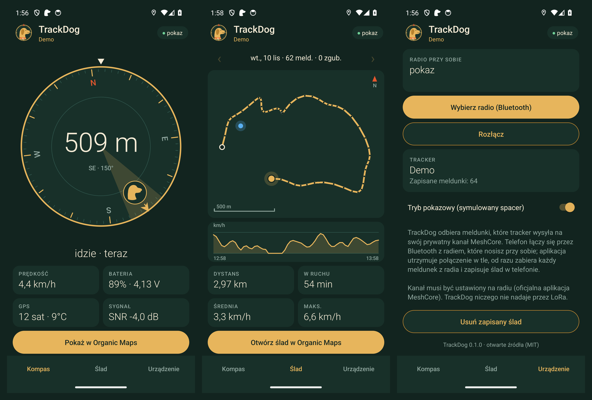

# TrackDog

Natywna aplikacja na Androida do śledzenia psa z trackerem LoRa w sieci [MeshCore](https://github.com/meshcore-dev/MeshCore) –
bez internetu, bez karty SIM i bez abonamentu.



*English summary:* TrackDog is a native Android app that follows a dog wearing a LoRa tracker (Seeed SenseCAP T1000-E
with the [meshcore-tracker](https://github.com/qbarteczek/meshcore-tracker) firmware). The phone connects over
Bluetooth to the MeshCore companion radio you carry, takes every position report out of it the moment it arrives,
stores the trail on the phone and shows distance and direction to the dog on a compass. No internet, no SIM, no
account. The trail of a day opens in Organic Maps as a GPX track. MIT licence, no third-party libraries.

## Jak to działa

```
tracker na psie (T1000-E) ──LoRa──► radio MeshCore w kieszeni (companion) ──Bluetooth──► telefon z TrackDog
        │
        └──LoRa──► repeater ──► węzeł w domu ──► serwer (np. Traccar) – niezależnie od telefonu
```

1. Tracker co 30–300 s (zależnie od ruchu i prędkości) wysyła meldunek tekstowy na prywatny kanał MeshCore.
2. Radio, które nosisz przy sobie (zwykły companion MeshCore, np. XIAO nRF52840 + Wio-SX1262), odbiera meldunek.
3. TrackDog działa jako usługa w tle: trzyma połączenie Bluetooth z radiem także przy zgaszonym ekranie,
   **od razu zabiera każdy meldunek z radia** i zapisuje go w bazie w telefonie.

Punkt 3 rozwiązuje dwa kłopoty, od których zaczął się ten projekt: meldunki nie zalegają w małej pamięci radia
(kolejka companiona mieści 256 wiadomości i nie przetrwa restartu) i zostaje po nich **ślad**.

## Co potrafi wersja 0.1

- **Kompas** – tarcza obraca się z telefonem, głowa psa na obwodzie pokazuje kierunek, w środku odległość.
  Pod spodem: stan (idzie / biegnie / stoi / SOS), wiek meldunku, prędkość, bateria, satelity, temperatura, sygnał.
- **Ślad** – trasa wybranego dnia w skali, z północą u góry, kolorowana prędkością (szary: postój, złoty: chód,
  czerwony: bieg), wykres prędkości, dystans, czas w ruchu, prędkość średnia i największa, liczba meldunków
  odebranych i zgubionych (po numerach meldunków).
- **Organic Maps** – przycisk pokazuje pozycję psa albo otwiera ślad dnia jako plik GPX (zapisany też w
  `Pobrane/TrackDog`). Mapy offline pochodzą z Organic Maps; TrackDog sam nie pobiera żadnych map.
- **Powiadomienia** – stały pasek z ostatnim meldunkiem, osobny alarm przy SOS i słabej baterii trackera.
- **Tryb pokazowy** – symulowany spacer, żeby obejrzeć aplikację bez sprzętu.
- Polski i angielski. Bez kont, bez reklam, bez dostępu do internetu (aplikacja nie ma nawet takiego uprawnienia).

Aplikacja niczego nie nadaje przez LoRa i nie zmienia ustawień radia (poza ustawieniem zegara, jak każda aplikacja
MeshCore).

## Czego potrzebujesz

| Co | Uwagi |
|---|---|
| Telefon z Androidem 10 lub nowszym | Bluetooth LE |
| Tracker | SenseCAP T1000-E z firmware [meshcore-tracker](https://github.com/qbarteczek/meshcore-tracker) – [docs/FIRMWARE.md](docs/FIRMWARE.md) |
| Radio przy sobie | dowolny **companion MeshCore z Bluetooth**, z ustawionym kanałem trackera |
| Organic Maps | opcjonalnie, do map offline |

## Pierwsze uruchomienie

1. Wgraj firmware trackera i ustaw kanał na trackerze i na radiu – [docs/FIRMWARE.md](docs/FIRMWARE.md).
2. Zainstaluj TrackDog (plik APK z wydań albo zbuduj sam – niżej).
3. Zakładka **Urządzenie → Wybierz radio (Bluetooth)**. Wybierz radio, które nosisz przy sobie – **nie tracker**
   (gdy telefon jest połączony z trackerem, tracker nie melduje). Android zapyta o PIN radia (domyślny w MeshCore
   to `123456` – zmień go).
4. W ustawieniach Androida wyłącz dla TrackDog oszczędzanie baterii, żeby system nie usypiał usługi.
5. Oficjalną aplikację MeshCore rozłącz z tym radiem – radio obsługuje jedno połączenie Bluetooth naraz.

## Budowanie

Potrzebne: JDK 17 i Android SDK (platforma 34). Projekt nie ma zależności poza frameworkiem Androida.

```
./gradlew assembleDebug          # app/build/outputs/apk/debug/app-debug.apk
./gradlew testDebugUnitTest      # testy parsera meldunków i obliczeń śladu
adb install -r app/build/outputs/apk/debug/app-debug.apk
adb shell am start -n pl.qbart.trackdog/.MainActivity --ez demo true    # od razu tryb pokazowy
```

## Kod

| Plik | Co robi |
|---|---|
| [MeshLink.kt](app/src/main/java/pl/qbart/trackdog/MeshLink.kt) | Bluetooth LE i protokół companiona MeshCore (tylko odbiór) |
| [TrackService.kt](app/src/main/java/pl/qbart/trackdog/TrackService.kt) | usługa w tle, powiadomienia, tryb pokazowy |
| [Report.kt](app/src/main/java/pl/qbart/trackdog/Report.kt) | meldunek, parser tekstu, geometria, statystyki śladu |
| [Store.kt](app/src/main/java/pl/qbart/trackdog/Store.kt) | baza SQLite ze śladem |
| [CompassView.kt](app/src/main/java/pl/qbart/trackdog/CompassView.kt), [TrailView.kt](app/src/main/java/pl/qbart/trackdog/TrailView.kt) | rysowanie kompasu, śladu i wykresu |
| [Util.kt](app/src/main/java/pl/qbart/trackdog/Util.kt) | teksty, eksport GPX, przekazanie do Organic Maps |
| [design/logo.svg](design/logo.svg) | znak: profil retrievera w kompasie; `design/make_icons.py` robi z niego ikony |

Format meldunku i ramki protokołu: [docs/PROTOCOL.md](docs/PROTOCOL.md).

## Plany

Aplikacja będzie rozwijana po kolejnych wędrówkach. Na liście: mapa w aplikacji, ślad właściciela obok śladu psa,
strefy i alarm oddalenia, przekazywanie pozycji na własny serwer, gdy telefon ma zasięg, podział dnia na spacery.

## Prywatność

Pozycje zostają w telefonie. Meldunki są szyfrowane kluczem kanału MeshCore – widzi je tylko ten, kto ma ten klucz.
Tym samym trackerem można śledzić osobę wyłącznie za jej zgodą.

## Licencja

MIT – [LICENSE](LICENSE). TrackDog nie jest oficjalnym produktem zespołu MeshCore ani Organic Maps.
