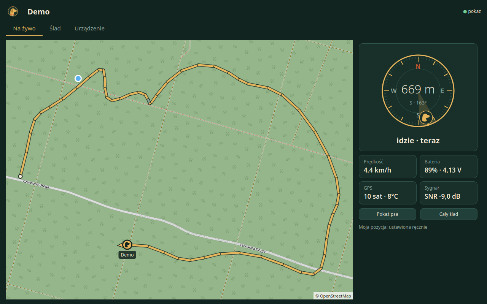

# TrackDog na komputer (Linux i Windows)

Wersja TrackDog na komputer. Odbiera te same meldunki trackera co aplikacja na Androida i zapisuje je w takiej
samej bazie, więc spacery z telefonu i z komputera można łączyć w obie strony.



*English summary:* the desktop version of TrackDog for Linux and Windows (Python + Qt). It connects to a MeshCore
companion radio over Bluetooth LE, a USB cable or Wi-Fi (TCP), takes every tracker report out of the radio, stores
the trail in the same SQLite table as the phone and shows it on an OpenStreetMap map (tiles cached on disk). Trails
move between phone and computer as an exported database. Report parsing, trail statistics, GPX and the shared texts
are checked against the same test vectors as the Android app ([../shared/vectors.json](../shared/vectors.json)).

## Co potrafi

| Zakładka | Co pokazuje |
|---|---|
| **Na żywo** | mapa ze śladem z ostatnich 3 godzin i psem (strzałka = kurs), kompas z odległością i kierunkiem od **Twojej pozycji**, stan, wiek meldunku, prędkość, bateria, GPS, sygnał |
| **Ślad** | ślad wybranego dnia na mapie, kolorowany prędkością (szary: postój, żółty: chód, czerwony: bieg), wykres prędkości, dystans, czas w ruchu, średnia, maksimum, liczba meldunków odebranych i zgubionych; zapis do GPX |
| **Urządzenie** | wybór radia, tracker, tryb pokazowy, import i eksport meldunków, mapa (OpenStreetMap / OpenTopoMap), język, praca w tle |

- **Połączenie z radiem**: Bluetooth LE, kabel USB albo Wi-Fi (TCP, np. companion na ESP32 z Wi-Fi). Program niczego
  nie nadaje przez LoRa; ustawia tylko zegar radia, jak każda aplikacja MeshCore. Po zerwaniu łączy się sam ponownie.
- **Twoja pozycja**: komputer nie ma GPS ani kompasu, dlatego odległość i kierunek liczone są od pozycji radia
  (gdy radio ma GPS lub ustawioną pozycję) albo od punktu wskazanego na mapie: **prawy przycisk → Tu jestem**.
  Na kompasie północ jest zawsze u góry.
- **Mapa**: kafelki OpenStreetMap pobierane z internetu i **zapisywane na dysku**. Miejsca obejrzane raz widać potem
  bez internetu. Map Mapsforge (`.map`) z telefonu ta wersja nie czyta.
- **Alarmy**: SOS i słaba bateria trackera dają dźwięk, mignięcie okna i komunikat przy zegarze.
- **Praca w tle**: zamknięcie okna chowa TrackDog do ikony przy zegarze, a program słucha dalej (można to wyłączyć).
  **Zakończ** w menu ikony wyłącza go całkiem.

## Przenoszenie spacerów między telefonem a komputerem

Obie wersje zapisują meldunki w takiej samej tabeli SQLite. Meldunek, który już jest w bazie (ten sam tracker
i ten sam czas), przy imporcie jest pomijany, więc import można powtarzać bez dublowania.

- **Telefon → komputer**: w telefonie *Urządzenie → Eksportuj meldunki (na komputer)* zapisuje plik
  `Pobrane/TrackDog/trackdog-RRRR-MM-DD.db`. Przenieś go na komputer (kabel, chmura, e-mail) i wybierz
  *Urządzenie → Import z telefonu…*.
- **Komputer → telefon**: *Eksportuj meldunki (na telefon)…*, plik na telefon, w telefonie *Importuj meldunki z pliku*.
- **GPX**: komputer wczytuje też pliki GPX, np. zapisane wcześniej przez TrackDog. GPX ma tylko pozycję, czas
  i prędkość, bez baterii i numerów meldunków, dlatego lepiej przenosić bazę.

## Radio rozmawia tylko z jednym urządzeniem

Companion MeshCore obsługuje jedno połączenie Bluetooth naraz, a meldunek zabrany z radia przez jedno urządzenie
nie trafi już do drugiego. Na spacerze radio jest połączone z telefonem. Na komputerze TrackDog przydaje się, gdy:
- radio leży w domu na kablu USB albo w zasięgu Bluetooth komputera (pies w ogrodzie, na działce),
- telefon się rozładował albo został w domu (laptop w samochodzie),
- trzeba obejrzeć ślady na dużym ekranie: po imporcie z telefonu nie potrzeba żadnego radia.

## Instalacja

### Windows

Pobierz `TrackDog-Setup-x.y.z.exe` z wydań i uruchom go. Instaluje się tylko dla bieżącego użytkownika, bez
uprawnień administratora; na pierwszej stronie wybierasz język. Parowanie z radiem przez Bluetooth (PIN) program
robi sam, przez Windows (WinRT).

### Linux

Gotowy program: rozpakuj `TrackDog-x.y.z-linux-x86_64.tar.gz` i uruchom `TrackDog/install-linux.sh`. Skrypt
dodaje TrackDog do menu programów.

Ze źródeł (Python 3.11 lub nowszy):

```
cd desktop
./install-linux.sh                      # .venv z requirements.txt + wpis w menu
.venv/bin/python trackdog_desktop.py    # albo z menu: TrackDog
```

**Bluetooth na Linuksie**: radio sparuj raz w systemie, np. `bluetoothctl` → `scan on` → `pair AA:BB:…` i wpisz
PIN z ekranu radia (domyślnie `123456`). Jeśli pulpit ma własnego agenta Bluetooth (KDE, GNOME), zapyta
o PIN sam przy pierwszym połączeniu. Do kabla USB użytkownik musi być w grupie `uucp` (Arch, Manjaro) albo
`dialout` (Debian, Ubuntu).

## Dane

| System | Folder |
|---|---|
| Linux | `~/.local/share/TrackDog/` |
| Windows | `%APPDATA%\TrackDog\` |

W folderze: `trackdog.db` (meldunki), `config.json` (ustawienia), `tiles/` (kafelki mapy), `trackdog.log`.

## Budowanie i testy

```
python -m venv .venv
.venv/bin/pip install -r requirements-dev.txt      # Windows: .venv\Scripts\pip
.venv/bin/python -m unittest discover -s tests     # te same wektory testowe co w aplikacji na Androida
.venv/bin/python trackdog_desktop.py --demo        # od razu tryb pokazowy
.venv/bin/python build.py                          # dist/: Linux → tar.gz, Windows → instalator (Inno Setup 6)
```

Program buduje się na tym systemie, na którym ma działać: paczkę dla Windows trzeba zbudować na Windows.
`build.py` kopiuje teksty i znak z aplikacji na Androida (`app/src/main/res`, `design/logo.svg`), więc obie wersje
mają te same napisy.

| Plik | Co robi | Odpowiednik w Androidzie |
|---|---|---|
| [tdd/report.py](tdd/report.py) | meldunek, parser, geometria, statystyki śladu | Report.kt |
| [tdd/store.py](tdd/store.py) | baza SQLite (ta sama tabela), import i eksport | Store.kt |
| [tdd/link.py](tdd/link.py) | połączenie z radiem (BLE, USB, TCP) przez bibliotekę `meshcore` | MeshLink.kt |
| [tdd/gpx.py](tdd/gpx.py) | GPX (plik identyczny co do bajtu) | Util.kt (`Maps.gpx`) |
| [tdd/fmt.py](tdd/fmt.py), [tdd/i18n.py](tdd/i18n.py) | teksty; wspólne napisy czytane z `strings.xml` Androida | Util.kt (`Fmt`), res/values* |
| [tdd/demo.py](tdd/demo.py) | tryb pokazowy (ten sam spacer) | TrackService.kt |
| [tdd/mapview.py](tdd/mapview.py), [tdd/widgets.py](tdd/widgets.py) | mapa z kafelkami, kompas, wykres | TrailMap.kt, CompassView.kt, TrailView.kt |
| [tdd/ui.py](tdd/ui.py) | okno, zakładki, alarmy, ikona przy zegarze | MainActivity.kt, TrackService.kt |
