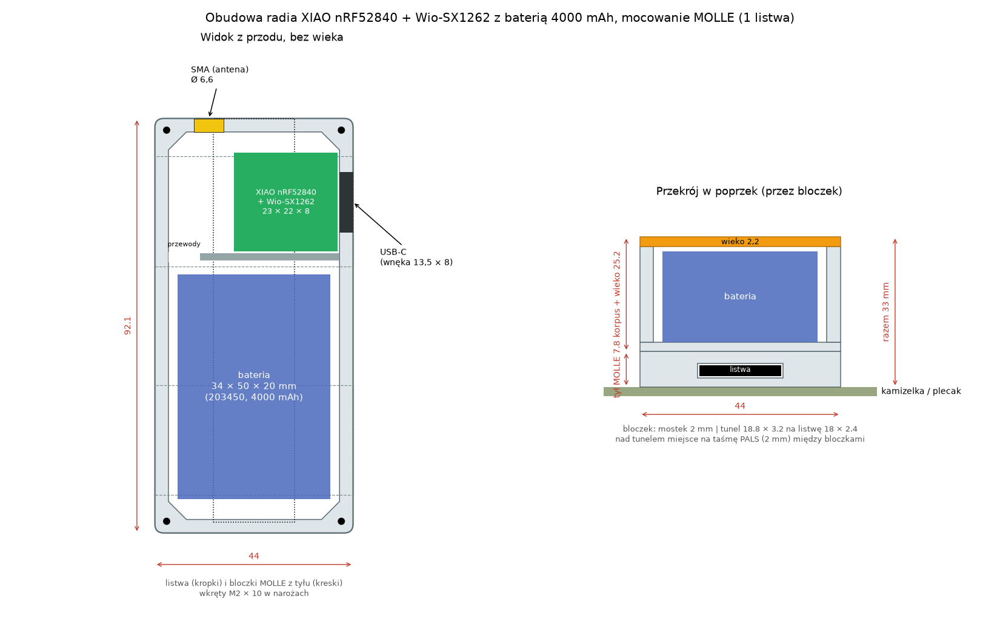

# Obudowa radia XIAO nRF52840 + Wio-SX1262 na MOLLE

Obudowa do druku na radio MeshCore noszone przy sobie (companion albo baza polowa trackera):
zestaw **Seeed XIAO nRF52840 + Wio-SX1262**, bateria LiPo **203450 4000 mAh**, gniazdo **SMA** na antenę,
otwór **USB-C** do ładowania i mocowanie **MOLLE/PALS** na kamizelce lub plecaku jedną listwą z zatrzaskiem.

| Część | Plik | Druk |
|---|---|---|
| podstawa | [stl/podstawa.stl](stl/podstawa.stl) | na stojąco, dolnym końcem (strona baterii) do stołu, z brimem i **podporami tylko od stołu** (pod dolnymi ścianami obu bloczków MOLLE). Tunele i otwór SMA wychodzą pionowo. Tak ułożone warstwy przenoszą szarpnięcie wzdłuż ścieżek; na plecach podpór nie trzeba, ale szarpnięcie rozrywa wtedy warstwy |
| wieko | [stl/wieko.stl](stl/wieko.stl) | płasko, frontem do stołu |
| listwa (+ zapasowa) | [stl/listwy.stl](stl/listwy.stl) | płasko, 100% (rectilinear); **PETG** albo PA, nie PLA |
| próba USB | [stl/test_usb.stl](stl/test_usb.stl) | wycinek ścianki z otworem USB i kołkami zestawu; 10 min druku, sprawdź wtyczkę, zanim wydrukujesz całość |

Wymiary: korpus 44 × 92 mm, grubość 33,8 mm (w tym 8,6 mm mocowania MOLLE z tyłu). Masa wydruków ok. 60 g w PETG (podstawa 40 g, listwa 6 g). Wnętrze 38 × 86 × 21 mm.
Źródło: [obudowa.scad](obudowa.scad) (OpenSCAD 2025+, `--backend=Manifold`; podstawa renderuje się ok. 40 s).

## Układ

- **Dół**: bateria 34 × 50 × 20 mm płasko na dnie. Na długości komora ma 3 mm zapasu na przewody
  i płytkę zabezpieczającą, na szerokości 2 mm z każdej strony, nad baterią 1 mm (pianka).
- **Żebro** oddziela baterię od elektroniki; przewody baterii przechodzą wycięciem po lewej.
- **Góra**: zestaw XIAO + Wio-SX1262 (23 × 22 × 8 mm) dosunięty gniazdem USB-C do prawej ścianki,
  ustalony narożnymi kołkami (bez pełnych ścianek, żeby był dostęp do U.FL). Wieko dociska go słupkiem
  przez podkładkę z pianki (1 mm).
- **Antena**: otwór Ø 6,6 mm w górnej ściance na gniazdo SMA bulkhead (pigtail U.FL → SMA, ok. 10 cm).
  Antena wychodzi do góry. Dla gniazd ze spłaszczonym gwintem ustaw `sma_flat` (np. 5,9).
- **USB-C**: wnęka 13,5 × 8 mm przez całą ściankę. Przy cieńszej ściance zwykła wtyczka nie dochodzi do gniazda.
- **Wieko** z kołnierzem 2,5 mm wchodzącym we wnętrze, 4 wkręty M2 × 10 do plastiku w fazowanych narożnikach.

## Mocowanie MOLLE

PALS: rzędy taśmy 1" co 1", szwy co 1,5". Z tyłu są dwa poziome bloczki, które wchodzą w przerwy między rzędami.
**Jedna listwa** idzie pionowo przez środek: bloczek, pod rzędem taśmy, bloczek, i zatrzaskuje się grotem za
ostatnim bloczkiem. Zdejmowanie: ściśnij oba ramiona grotu palcami i wysuń listwę za główkę.
Grot jest taki sam jak w sprawdzonej obudowie trackera T1000-E (ramiona 40 mm, zaczep 2 mm, r 0,4), listwa jest grubsza (3,2 mm zamiast 2,4), bo jedna przenosi całe obciążenie.

Dwie listwy co 38,1 mm: `listwy_ile = 2` (płyta tylna rozszerza się wtedy do 64 mm).
Pod dwoma rzędami: `pas_ile = 2` (wymaga dłuższej obudowy, ok. 125 mm).

## Do zmierzenia przed drukiem (oznaczone (!) w pliku)

| Parametr | Co | Domyślnie |
|---|---|---|
| `bat_x`, `bat_y`, `bat_z` | **bateria**. „203450” to zwykle 2,0 × 34 × 50 mm (ok. 400 mAh); 4000 mAh przy tej podstawie wymaga ok. 20 mm grubości | 34 × 50 × 20 |
| `usb_z`, `usb_y` | środek gniazda USB-C nad spodem zestawu i przesunięcie w bok | 6,3 / 0 |
| `pas_grub` | grubość taśmy PALS | 2,0 |

Granice komory przy domyślnych ustawieniach (test kolizji): bateria mieści się do **35 × 52,5 × 21 mm**.
Większa = zmień `bat_*` i wydrukuj od nowa (obudowa sama się powiększy).

## Testy

**Pasowanie** (`bash test_pasowania.sh`): przecięcia brył w OpenSCAD, objętość ma być 0:
bateria, zestaw, gniazdo SMA, wtyczka USB-C wsunięta do końca, wieko z kołnierzem i dociskiem, listwa
zatrzaśnięta w tunelach, taśma PALS. 14/14 OK.

**Wytrzymałość** (MES z G-code, narzędzie `symulacja-wydrukow`, przypadki w [testy-wytrzymalosci/](testy-wytrzymalosci/)):
PETG, dysza 0,4, warstwa 0,2, 3 obrysy (2026-11-15):

| Przypadek | Obciążenie | PETG | PLA | Wymagane |
|---|---|---|---|---|
| zatrzask listwy ([zatrzask_petg.py](testy-wytrzymalosci/zatrzask_petg.py)) | ściśnięcie grotu 2 mm na ramię, wiele cykli | **SF 2,37** OK, 11,4 N na ramię | SF 1,72, za mało | 2 |
| listwa przy szarpnięciu ([listwa_szarpniecie.py](testy-wytrzymalosci/listwa_szarpniecie.py)) | obudowa zaczepiona o gałąź, 60 N od kamizelki, raz | **SF 1,57** OK | SF 1,84 | 1,5 |
| podstawa ([podstawa_szarpniecie.py](testy-wytrzymalosci/podstawa_szarpniecie.py)) | to samo 60 N na mostki bloczków, gyroid 25% | **SF 16,5** OK | – | 1,5 |

Pierwsza wersja listwy (2,4 mm, jak w obudowie T1000-E) przy szarpnięciu 60 N miała SF 0,97 i pękłaby
na rzędzie taśmy, tam gdzie zaczynają się ramiona grotu. Jedna listwa przenosi całe obciążenie, więc jest
pogrubiona do 3,2 mm. Zginanie rośnie z kwadratem grubości, a odkształcenie zatrzasku się nie zmienia, bo ramiona
uginają się w płaszczyźnie listwy. Przy zwykłych wstrząsach (ok. 15 N) listwa ma SF ok. 6.
Listwa z PLA wytrzyma szarpnięcie, ale zatrzask pęknie po wielu zdjęciach, więc **listwy tylko z PETG**.
Mapy wytężeń: [testy-wytrzymalosci/wyniki/](testy-wytrzymalosci/wyniki/).

## Montaż

1. Gniazdo SMA w górnej ściance (podkładka/oring na zewnątrz, nakrętka od środka), pigtail do U.FL zestawu.
2. Zestaw na kołki, USB-C w otworze. Bateria na dno (pianka lub taśma dwustronna), przewody przez wycięcie w żebrze
   do padów BAT+ / BAT− na spodzie XIAO. **Przed zamknięciem sprawdź polaryzację**: wtyczki JST różnych baterii
   mają odwrotne przewody.
3. Podkładka z pianki na zestaw, wieko, 4 wkręty M2 × 10.
4. Na kamizelce: obudowa bloczkami w przerwy między rzędami, listwa od dołu przez bloczek, pod rzędem, przez
   górny bloczek, aż grot kliknie.

Bez wyłącznika: radio działa, dopóki bateria jest podłączona. XIAO ładuje baterię z USB-C (ok. 50/100 mA, więc
4000 mAh ładuje się długo, ok. 40 h przy 100 mA).

Pliki pomocnicze: [rysunek.py](rysunek.py) (zarys z wymiarami z pliku `.scad`), [objetosc.py](objetosc.py).
